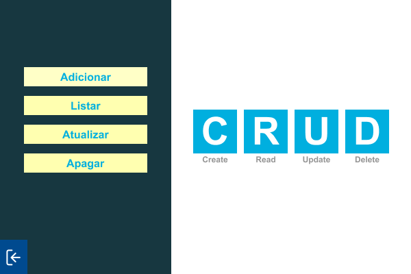

# Java CRUD CSV

Aplicação desktop usando Java para manipulação de arquivos CSV e realização de operações CRUD (Create, Read, Update e Delete).

> [!IMPORTANT] **Nota**
>
> Aplicação para fins de estudo e aprendizagem, com o objetivo de praticar Java, Java Swing, operações CRUD e manipulação de arquivos CSV.

## Imagens

**01 - Tela inicial com os botões de operações CRUD**

