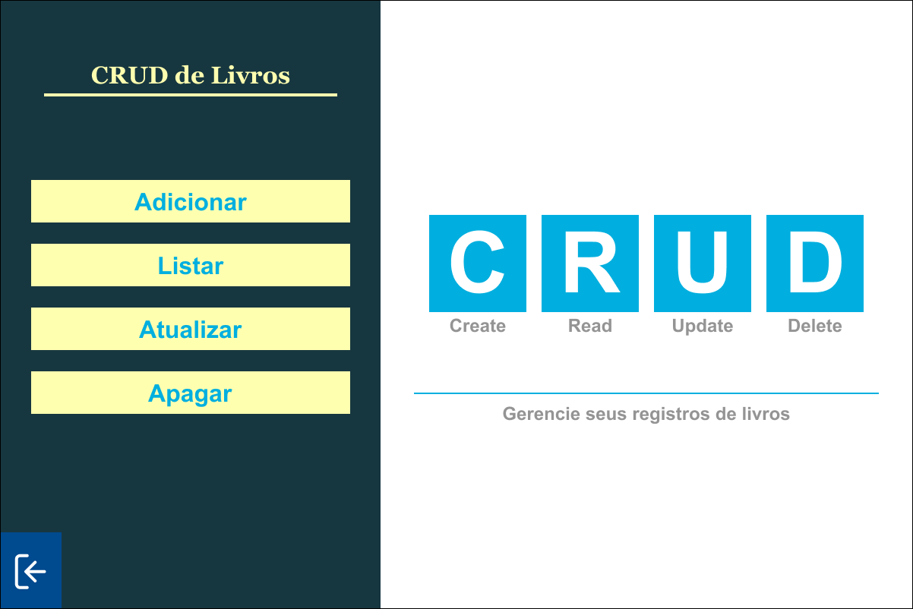
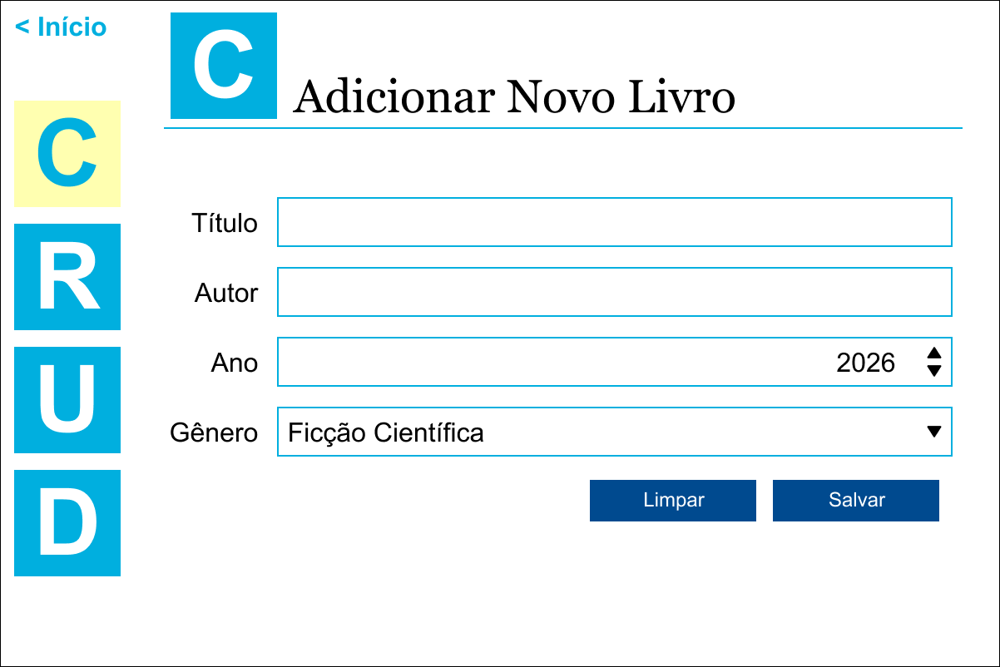
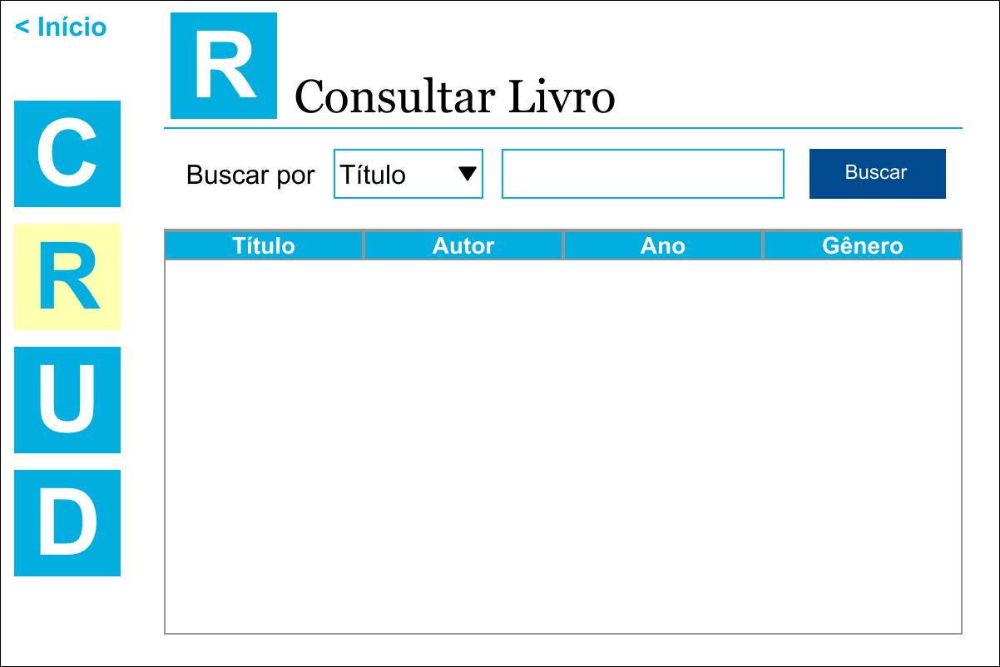
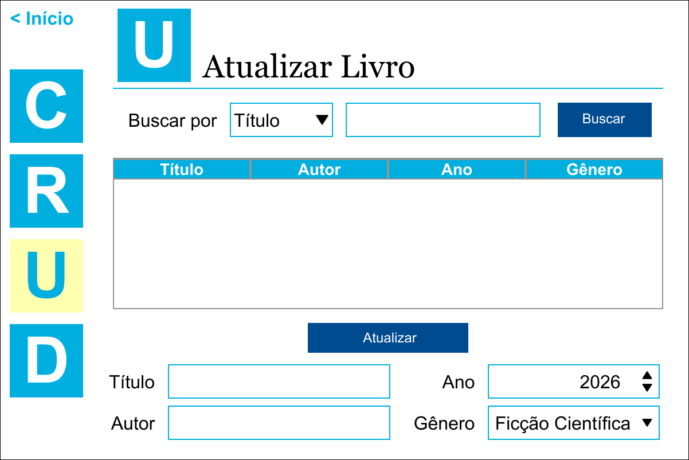
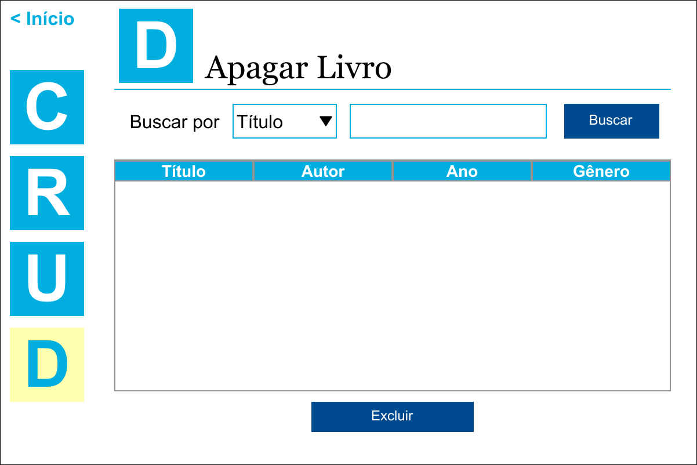

# CRUD de Livros (usando Java e CSV)

Aplicação desktop usando Java para manipulação de arquivos CSV e realização de operações CRUD (Create, Read, Update e Delete).

> [!NOTE]
> **Finalidade do projeto**
>
> Aplicação para fins de estudo e aprendizagem, com o objetivo de praticar Java, Java Swing, operações CRUD e manipulação de arquivos CSV.

## Imagens

**01 - Tela inicial com os botões de operações CRUD**

 

**02 - Tela para cadastrar novos livros (CREATE)**

 

**03 - Tela para consultar os livros (READ)**

 

**04 - Tela para atualizar os livros (UPDATE)**

 

**05 - Tela para apagar livros (DELETE)**

